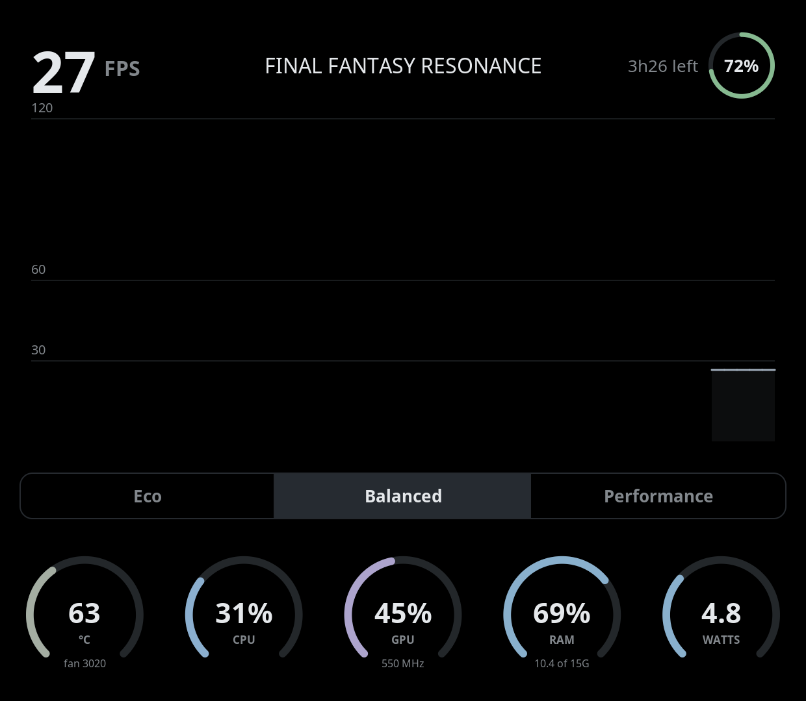

# thorhud

A quiet performance dashboard for the bottom screen of the AYN Thor running
[Armada OS](https://armadaos.dev/) — the Linux stand-in for the stock Android
overlay.



From top to bottom:

- **Header:** FPS (from gamescope's stats pipe; 0 when the screen is static), the focused game's title, and a
  battery ring with time left or time to full.
- **Graph:** the history of whichever stat you tap — the FPS readout, the battery corner, or any meter. FPS,
  CPU, GPU and watts show the last 2 minutes, temperature and RAM 5, battery 2 hours, with reference lines and
  a tick at the midpoint of the time axis. Noisy stats are drawn as a short moving average over a faint fill
  of the raw readings. The graphed stat gets a subtle highlight; tap it again for an empty, quiet middle. The
  choice is remembered across restarts.
- **Meters:** hottest CPU/GPU temperature with fan speed, CPU %, GPU % (from DRM fdinfo) with its clock, RAM,
  and watts (battery draw, or USB input while charging).
- **Profile:** Eco / Balanced / Performance through Armada's `org.armada.Power` D-Bus service — no root needed.
  Each profile carries a CPU governor, which the HUD reasserts whenever the profile changes (including from
  Steam): Eco → conservative, Balanced → schedutil, Performance → performance.

**Brightness swipes:** drag up or down anywhere — the left half sets the bottom screen's brightness, the right
half the top's. Any touch that moves more than a few pixels is a swipe, even one starting on a button; only
taps that stay put press buttons or pick graphs. This goes through logind's `Session.SetBrightness`. Armada
re-applies its own saved bottom-screen brightness every 2 s, so bottom swipes only stick once that setting is
moved aside (`sudo mv /etc/armada/bottom-screen-brightness /etc/armada/bottom-screen-brightness.bak`); the HUD
then keeps its own in `~/.local/state/thor-hud/bottom-brightness`.

**AYN button:** turns the bottom screen off and on. Off is true black on the OLED with the bottom touchscreen
ignored; the HUD keeps sampling, so the graphs carry on. Out of the box InputPlumber maps the button to
nothing useful, so route it to the HUD once with `sudo ./ayn-button.sh` (from the release folder or the repo).
It installs an override of InputPlumber's AYN capability map in `/etc/inputplumber/capability_maps.d`;
`sudo ./ayn-button.sh --remove` takes it out.

**Colours** are muted, equal in lightness and drawn on true black for the OLED panel. CPU, GPU and RAM share a
teal / violet / blue family. Temperature, battery draw and RAM shift from blue through amber to red as they
climb; the battery ring is blue when full, then green (≥40%), yellow (≥15%), red (≥5%) and bright purple.

## Install

On the Thor (Armada OS, user `armada`), from a terminal or over SSH:

```bash
curl -L https://github.com/mtklein/thorhud/releases/latest/download/thor-hud-aarch64.tar.gz | tar xz
./thor-hud-aarch64/install.sh
```

It installs into `~/.local` and `~/.config` (no root), enables the service and
starts it. The service is tied to `armada-bottom-screen.service`, so it starts
whenever the bottom screen's Plasma session does, pinned to the little cores
(0–2) at nice 10. If you close it, "Thor HUD" in the bottom screen's app drawer
brings it back.

## Build

A plain Wayland client in C: it rasterises its own pixels (distance-field arcs,
lines and rounded boxes; FreeType glyphs cached once) into shared-memory
buffers, sends only the regions that changed, and handles touch itself. GLib
provides the event loop and D-Bus. It runs pinned to the little cores and uses
around 1–2% of one of them.

Armada's image has no compiler, so build in a Fedora toolbox (same Fedora
release as Armada, so the binary runs on the host):

```bash
toolbox create --distro fedora --release 44
toolbox run -c fedora-toolbox-44 sudo dnf install -y gcc make pkgconf-pkg-config \
    wayland-devel wayland-protocols-devel freetype-devel fontconfig-devel glib2-devel zlib-ng-compat-devel
toolbox run -c fedora-toolbox-44 make
```

## Install from source

On the Thor (user `armada`), from the repo after building:

```bash
./install.sh
```

`make dist` builds the release tarball (`thor-hud-aarch64.tar.gz`): a stripped
binary plus `install.sh`, the service and launcher files.

## Testing

`thor-hud --windowed` runs in a 620×540 window; `thor-hud --snapshot out.png`
writes its own pixels to a PNG after a few seconds and exits; `thor-hud --stats`
prints the CPU time per tick spent sampling and drawing; `--show cpu` (or fps, temp,
gpu, ram, watts, battery, none) picks the graph at startup without saving it; `--snapshot-delay 60` waits
longer before the snapshot.
